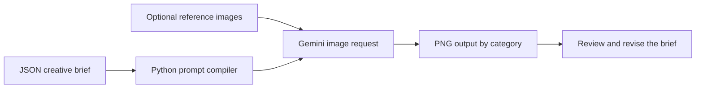

# AI Image Generation Workflow

A Python workflow that turns reusable JSON creative briefs into AI-generated images. It separates the subject, composition, lighting, environment, and visual style into editable fields, then compiles those fields into a prompt and saves the generated image in a matching category folder.

The project explores structured prompting for product photography, portraits, and educational infographics. It includes a Gemini generation script and Antigravity agent instructions, with generic examples for adapting the workflow to your own creative briefs.

---

## How it works

1. Create a JSON brief in `prompts/<category>/` with the subject, camera framing, lighting, setting, style, and elements to avoid.
2. Run `generate.py` with the path to that brief. The script combines the supported fields into a text prompt.
3. The script reads the model and image settings from the brief. Optional reference images are loaded from local paths when provided.
4. The Google GenAI SDK sends the prompt and any reference images to the configured model.
5. Returned images are saved to `images/<category>/<prompt-name>.png` for review.



---

## Components

| Component | Purpose |
| --- | --- |
| `generate.py` | Compiles supported JSON fields and requests image generation through Google GenAI |
| `prompts/` | Reusable creative briefs organized by category |
| `GEMINI.md` | Instructions for the Antigravity agent workflow |
| `.agents/skills/nano-banana/` | Structured prompting guidance and visual reference notes |

---

## How to use

Run these commands from the project folder:

```bash
python3 -m venv .venv
source .venv/bin/activate
python3 -m pip install -r requirements.txt
```

Set `GEMINI_API_KEY` in your environment or in a local `.env` file. Keep the key outside version control.

```bash
python3 generate.py prompts/people/young_woman_documentary.json
```

To select a model explicitly, supply a model ID available to your account:

```bash
python3 generate.py prompts/people/young_woman_documentary.json --model YOUR_IMAGE_MODEL_ID
```

The scripts contain model identifiers from the original experiments. Model availability and compatibility with image size, aspect ratio, and search grounding settings must be checked with the provider before running them.

For Antigravity, the included instructions describe a workflow in which the agent creates the JSON brief and runs the generator. The Python command can also be used independently.

---

## Make it your own

Edit the brief's `subject`, `composition`, `lighting`, `environment`, and `style` sections to change the creative direction. Use `negative_prompt` for elements to avoid. The `technical` section controls aspect ratio, image size, optional search grounding, and optional local reference image paths.

Keep each variation in its own JSON file to preserve the brief behind an experiment. A repeated filename writes to the same output path, so rename the brief when you want to keep separate versions.

---

## Scope and limitations

Structured briefs make creative instructions easier to inspect and reuse. They do not guarantee realistic results, consistent identities, correct text, or scientifically accurate diagrams. Generated outputs still require human review.

The main compiler uses a defined set of JSON fields and does not enforce the full schema described in the agent instructions. Reference files that cannot be found produce warnings, and generation can continue without them. Multiple returned image parts use the same output filename.


This public download includes generic sample prompts. Supply your own reference images and keep API keys and private configuration outside version control. No automated image-quality evaluation or measured business results are claimed.
